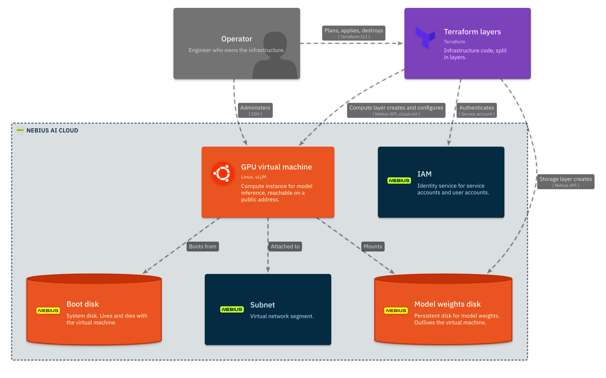
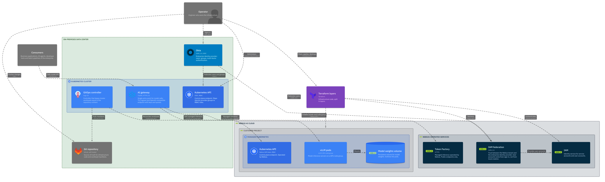
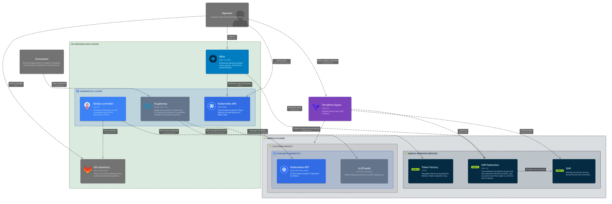
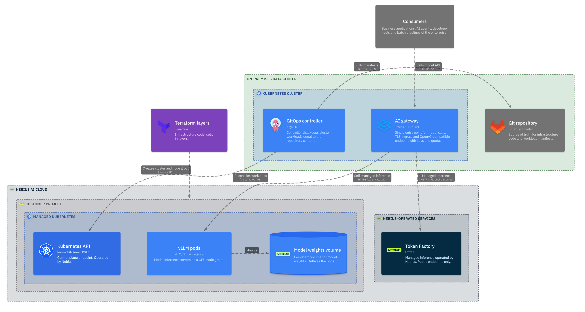

# Nebius inference sandbox

Self-managed model inference on Nebius AI Cloud, in two stages:

1. **Simple deployment** - one GPU virtual machine with vLLM, created by Terraform. This repository implements it. Use it as a template.
2. **Target federated architecture** - the same inference workload in an enterprise setup: Okta as identity provider, an on-premises Kubernetes cluster as platform, a Nebius Managed Kubernetes cluster for GPU workloads. This repository documents it; it does not implement it yet.

The diagrams come from the LikeC4 model in `docs/architecture/`. Browse them with `likec4 start docs/architecture`.

## 1. Simple deployment



One operator, two Terraform layers, one virtual machine.

| Element | Role |
|---|---|
| `tf/storage` | Creates the model weights disk. The disk outlives the virtual machine. |
| `tf/base` | Creates the GPU virtual machine and installs vLLM with cloud-init. |
| Service account | Identity that Terraform uses on the Nebius API. |
| SSH | Only access path to the virtual machine. The vLLM port is not open to the internet. |

### Use it

Prerequisites: Terraform, [Task](https://taskfile.dev), `jq`, a Nebius project, a subnet and a service account.

```bash
cp .env.template .env        # fill in project, subnet and service account IDs
task tf:storage:init && task tf:storage:apply
task tf:init && task tf:apply
task ssh                     # start vLLM on the machine
task chat -- "Say hello"     # one chat completion through SSH
```

`task tf:destroy` removes the virtual machine and keeps the model weights. `task tf:storage:destroy` deletes the weights.

### Limits

- One person, one static SSH key, one service account key. No central identity.
- One virtual machine. No scaling, no rolling update.
- Public address on the machine.

## 2. Target federated architecture



The target extends the Nebius interconnect schema for self-managed inference: consumers call an AI gateway in the on-premises cluster, and requests reach vLLM pods in Nebius. The diagrams stay at software level. The interconnect schema owns the network path (layer 4 and below).

### Decisions

| Topic | Decision |
|---|---|
| Platform cluster | On-premises Kubernetes. Hosts the AI gateway (Traefik: TLS ingress, keys, quotas) and the GitOps controller. |
| GPU workloads | Nebius Managed Kubernetes in the customer project. vLLM runs as pods on a GPU node group; weights live on a persistent volume. |
| Inference path | AI gateway to vLLM pods over HTTPS on the private path. No public model endpoint. |
| Identity provider | Okta, on the enterprise side, for engineers. |
| Nebius access | Okta federates users into the Nebius tenant with SAML 2.0. Console, CLI and Terraform use the federated account. |
| Cluster access | Engineers use the on-premises Kubernetes API only: Okta OIDC, groups mapped to RBAC roles. The Nebius cluster API has one client, the GitOps controller. |
| Delivery | Terraform creates infrastructure and the federation. The code lives in a self-hosted GitLab in the data center. The GitOps controller pulls it and reconciles the vLLM workload on the Nebius cluster. |
| Consumers | Enterprise applications, through the AI gateway only. Okta does not authenticate them; the gateway uses keys and quotas. |
| Managed inference | Token Factory stays available as a second backend, on public HTTPS only. |

### Who operates what in Nebius

| Layer | Content | Operated by |
|---|---|---|
| Nebius-operated services | IAM, IAM federation, Token Factory | Nebius. The customer configures them. |
| Customer project | Managed Kubernetes workloads, model weights | Customer. Nebius operates the Kubernetes control plane only. |

### Identity and trust boundaries



- An engineer has one identity, in Okta. Removal from Okta removes access to Nebius and to both clusters.
- One link joins the two clusters: the GitOps controller reconciles workloads on the Nebius Kubernetes API. Engineers do not call that API.
- Two non-human credentials remain: the Terraform service account and the service account that the GitOps controller uses on the Nebius cluster.

### Deployment



### Open points

- The mapping of Okta groups to Nebius groups is not in this design yet.

### From simple to target

| Simple deployment | Target |
|---|---|
| GPU virtual machine | GPU node group in Managed Kubernetes |
| vLLM installed by cloud-init | vLLM pods reconciled by GitOps |
| Model weights disk | Persistent volume |
| SSH key | Okta sign-in, federated into Nebius IAM and Kubernetes RBAC |
| Public address, SSH tunnel | Private endpoint, reached from the AI gateway only |
